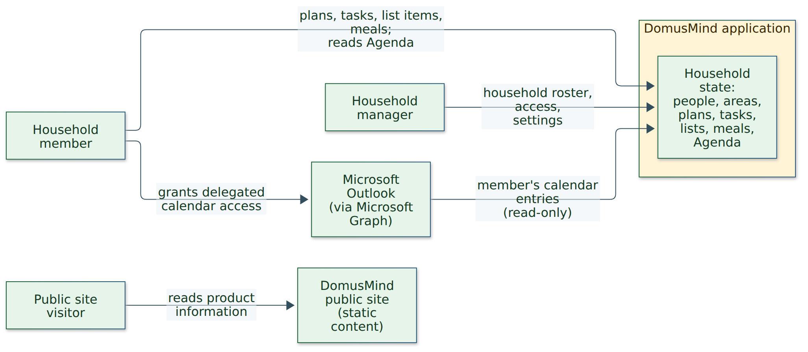
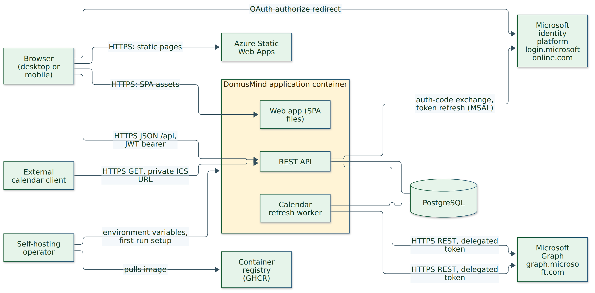

# Context and Scope

The system under description is the **DomusMind application**: the API and the web
app it serves, with its own database. The **public site** is a separate static system
in the same repository; it shares no data or runtime with the application and is
shown only to make that separation explicit.

## Business Context

<!-- diagram-source: ./diagrams/business-context-of-domusmind.mmd sha256:f5758acbd06dc11d0571708be2ac93984c9682f68bead658e3d811b1a9dc1423 png-sha256:98bd23f8e47ca318b92baf72b7b1a32402def167e438c967323aaff3707341ce -->

| Partner | Exchanges with DomusMind |
| --- | --- |
| Household member | Records and reads shared household state; may connect a personal Outlook calendar whose entries appear only in their own Agenda scope. |
| Household manager | Everything a member does, plus the household roster, member access and household settings. |
| Microsoft Outlook | Supplies a member's calendar entries through delegated access. DomusMind only reads; nothing flows back. |
| Public site visitor | Reads static product information on the public site. No exchange with the application; outbound links go to the GitHub repository. |

The two human partners and Outlook are the product's actors:

<!-- pdac:cite id="ACT-HOUSEHOLD-MEMBER" digest="sha256:15b65c1c587d35c6e28a20522a70a619060adda71cdb22dc0851a3812a8e2ec4" -->
<!-- pdac:cite id="ACT-HOUSEHOLD-MANAGER" digest="sha256:9e4e0dad11e4c8cb94efdebca7ef64b3dd6c21db313e05dbadaaf7f3807075fd" -->
<!-- pdac:cite id="ACT-MICROSOFT-OUTLOOK" digest="sha256:a274a18ef29171d475391275699318abf8c93ee7fa3daf494741dbe1fce6af66" -->

The product model also names a calendar sync scheduler actor. Architecturally it is
not a partner but a hosted background worker **inside** the boundary; it appears as an
outbound call to Microsoft Graph below.

<!-- pdac:cite id="ACT-CALENDAR-SYNC-SCHEDULER" digest="sha256:93756f5008efb26952e8def217428fcc7601ce2adecce3b0dddf877757493a33" -->

The public site visitor has no product-model actor; the site's content is governed by
[`docs/design/public-site.md`](../../design/public-site.md).

This diagram describes the current implementation. The approved product target adds
an operator-configured OIDC provider as an authentication partner; it has not yet
replaced the current local sign-in path. DomusMind does not send invitation email.

<!-- pdac:cite id="CON-PRODUCTION-OIDC-SIGN-IN" digest="sha256:eb9059ccb8ca63b54036bb940fc2b5c472e06357b2e2084a9ad7900c88b490a3" -->

Inbox and Chats are implemented alongside the original core areas. Their assistant
adapters send request text and authorized context to the configured hosted or local
provider, with the product's disclosure and review rules. Calendar subscription
clients receive a separate read-only projection. Household Assets is accepted
intent without a backend module. The diagrams above focus on the original core
context and omit these assistant-provider exchanges.

<!-- pdac:cite id="CON-PRODUCT-CURRENT-SCOPE" digest="sha256:86c4b7c550c3e4edf5c1f614510ece6a13274480c6333c7114e1a103f0219169" -->

## Technical Context

<!-- diagram-source: ./diagrams/technical-context-of-domusmind.mmd sha256:d1ddccc0c5f4246ee53e2ce5fe2de4ff61977326df6603420364cc1ddaf8f4df png-sha256:8ed2e4b559367a0679ea8bee62d5793c3496e917349708a0297e8f4806253ded -->

The browser is the only client. The SPA and the API are served by the same process
and origin, so the web app calls the API with relative `/api` paths. PostgreSQL is
part of the deployment rather than an external partner; its topology belongs to the
[deployment view](../07-deployment-view/README.md).

| Interface | Partner | Channel and protocol | Direction | Evidence |
| --- | --- | --- | --- | --- |
| Web app delivery | Browser | HTTP(S), static files with SPA fallback | Out | [`Program.cs`](../../../src/backend/DomusMind.Api/Program.cs) |
| Household API | Browser (web app) | REST over HTTP(S), JSON, JWT bearer access token with refresh token; OpenAPI at `/swagger` | In / out | [`Controllers/`](../../../src/backend/DomusMind.Api/Controllers/), [conventions](../08-crosscutting-concepts/README.md) |
| First-run setup | Operator via browser | Setup endpoints used by the setup wizard; optional bootstrap admin from environment for headless installs | In | [`deploy/.env.example`](../../../deploy/.env.example) |
| Configuration | Operator | Environment variables: database connection, JWT signing settings, Microsoft app registration, bootstrap admin | In | [`deploy/docker-compose.yml`](../../../deploy/docker-compose.yml) |
| Outlook authorization | Microsoft identity platform | OAuth 2.0 authorization code flow; the API builds the authorize URL, the browser is redirected, the API redeems the code through MSAL and keeps the token cache server-side (encryption depends on configuration, see [section 11](../11-risks-and-technical-debt/README.md)) | Out | [`Integrations/Calendar/Microsoft/`](../../../src/backend/DomusMind.Infrastructure/Integrations/Calendar/Microsoft/) |
| Calendar ingestion | Microsoft Graph v1.0 | HTTPS REST: calendar list and `calendarView` delta queries with the delegated `Calendars.Read` scope; pull only, manual or scheduled | Out (read) | [ADR-0003](../../adr/0003-use-delegated-graph-auth-for-outlook-calendar-ingestion.md) |
| Calendar subscription feed | External calendar client | HTTPS GET using a private subscription URL; read-only ICS response, no household sign-in | In (read) | [`CalendarSubscriptionsController.cs`](../../../src/backend/DomusMind.Api/Controllers/CalendarSubscriptionsController.cs) |
<!-- pdac:cite id="ACT-EXTERNAL-CALENDAR-CLIENT" digest="sha256:f6c0dfdd8f870fe475a479f7c9d0764f896cfe121f66fc876a9159cfdb7d9139" -->
| Image distribution | Container registry | OCI image pulled by the operator | Out of band | [`docker-edge.yml`](../../../.github/workflows/docker-edge.yml) |
| Public site | Browser | Static HTML on Azure Static Web Apps; no call to the application | Out | [`src/web/public/`](../../../src/web/public/) |
| Email, push, messaging | none | Not implemented | — | No sender in `src/backend` |

## Input and Output Channel Mapping

| Business exchange | Technical channel |
| --- | --- |
| Members and managers record and read household state | Household API, called by the web app in the browser |
| Household and member administration | Household API (manager-authorized endpoints) |
| Member grants Outlook access | Outlook authorization: browser redirect to the Microsoft identity platform, code redeemed by the API |
| Outlook entries reach the member's Agenda | Calendar ingestion from Microsoft Graph, triggered by the member through the API or by the refresh worker; served back through the Household API |
| First household and administrator are created | First-run setup (wizard or bootstrap admin) |
| Visitor reads product information | Public site on Azure Static Web Apps |

Boundary risks (token custody for Outlook connections, the Microsoft app-registration
dependency, transport security in front of the container) are assessed in
[section 11](../11-risks-and-technical-debt/README.md).
