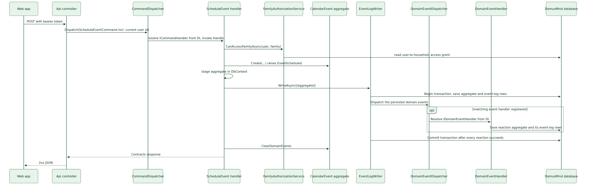
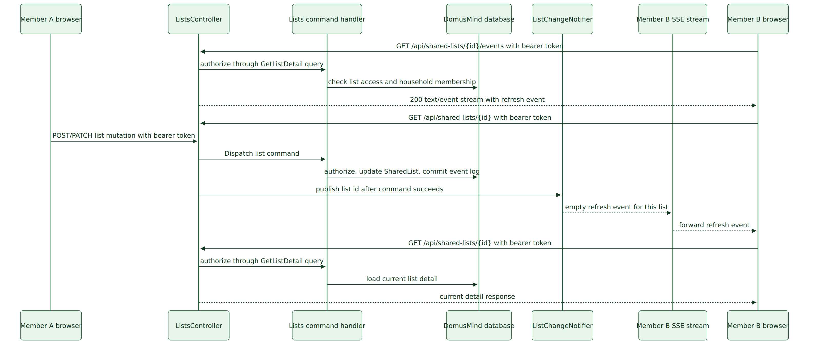
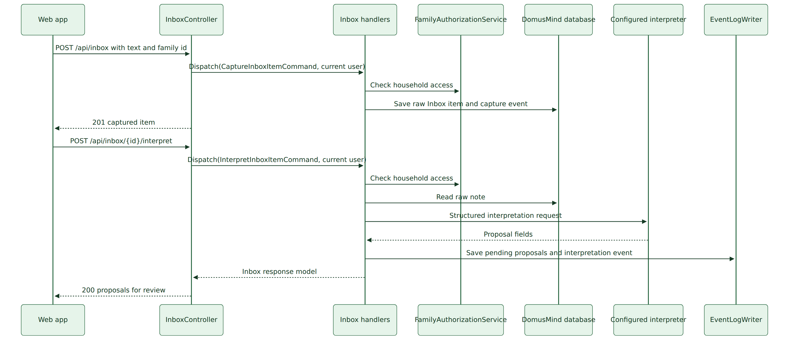
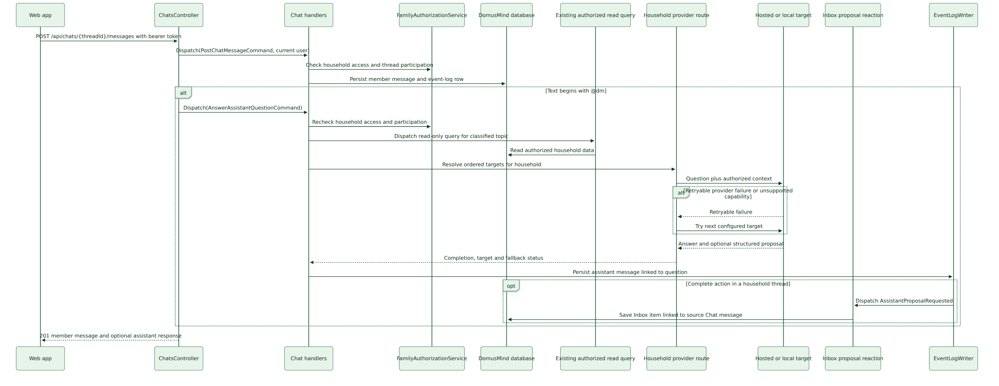
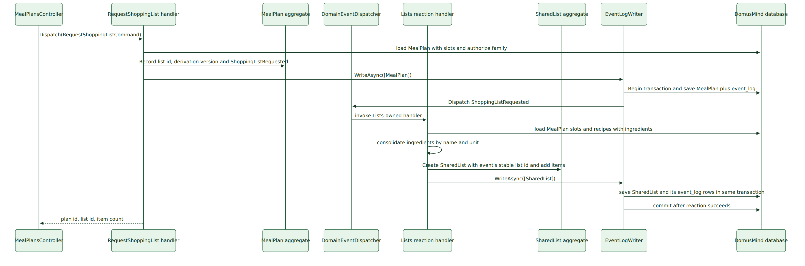
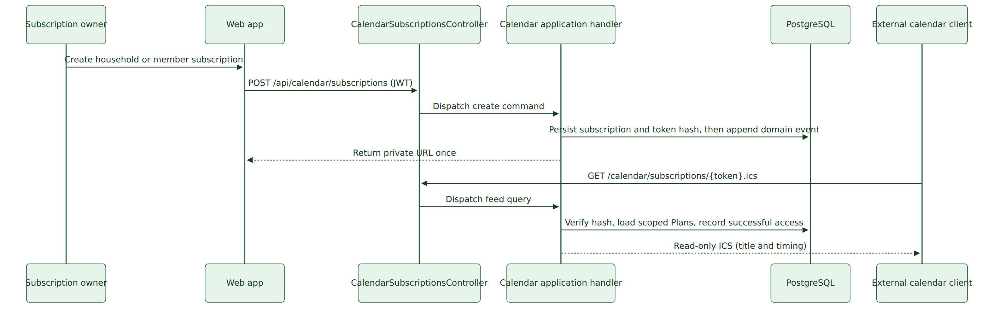
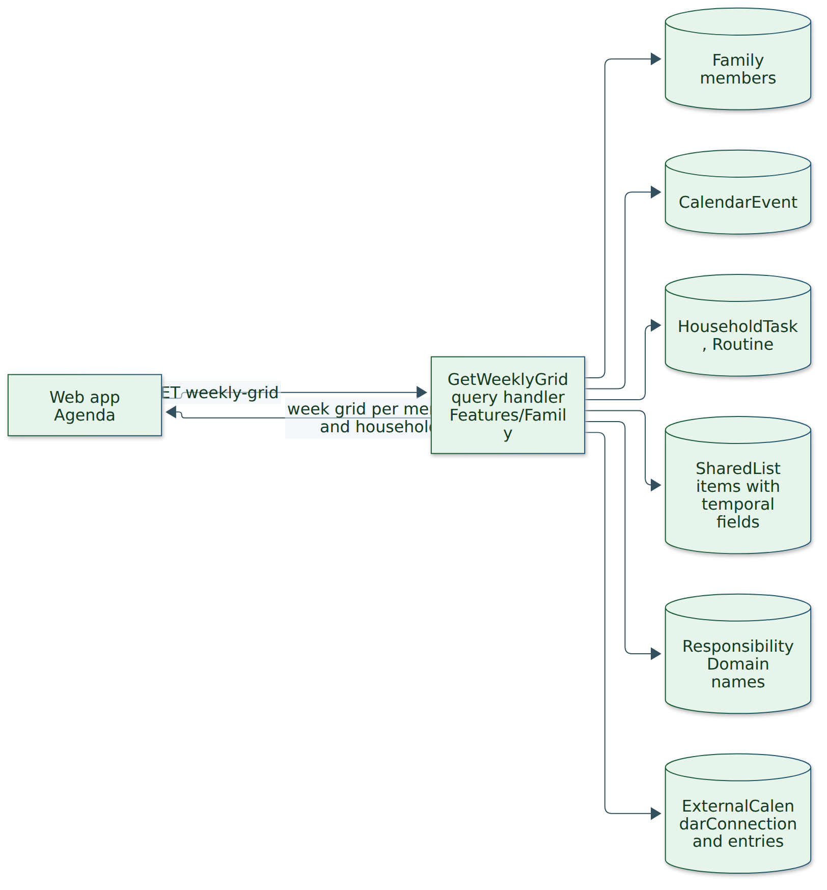
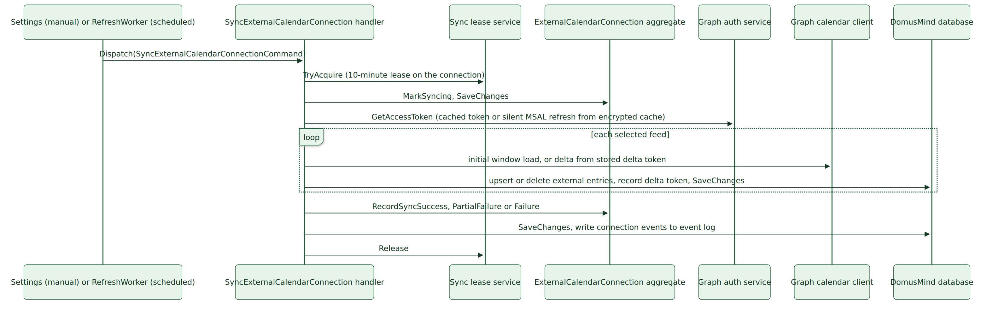
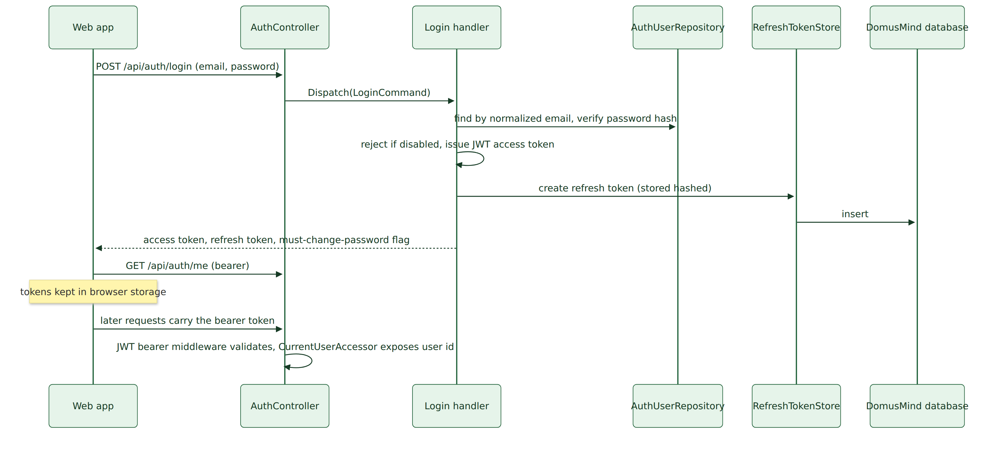

# Runtime View

## Development browser session pilot

With `Bff:Enabled` in development, the SPA opens `/api/session/login`; the API host challenges Keycloak through Authorization Code with PKCE. The callback accepts only a configured test subject whose verified email matches an active local `AuthUser`, then issues a Secure, HttpOnly cookie referencing a server-side authentication ticket. The in-memory ticket store revokes that ticket on logout and is limited to one development API process. The SPA calls the same-origin controllers without bearer tokens. Unsafe `/api` requests must carry the CSRF request token and matching Origin; production still uses the local JWT flow described below.

Participants are the building blocks of [section 05](../05-building-block-view/README.md). Each scenario describes the code as it runs today; where it differs from the intended design the difference is stated and tracked in [section 11](../11-risks-and-technical-debt/README.md).

## Command through the internal dispatcher

Every state change follows the same path through the internal mediator ([ADR-0001](../../adr/0001-use-an-internal-application-mediator.md)). Scheduling a plan is representative.

<!-- diagram-source: ./diagrams/command-through-the-internal-dispatcher.mmd sha256:c6d5de3977f4e42b786a3fb1533335cd73e6195608e39a5b1aa32da248bdc64d png-sha256:e56cb3f878a4b5a3a9c72b637ba707f3a5888935d0a5fff3586e81224bd5ed56 -->

### Notable Interactions

- The controller adds only the authenticated user's id to the command; the handler decides access to the household and enforces it itself. There is no dispatcher pipeline: validation, authorization and mapping happen inside the handler.
- The event-log writer saves aggregate state and event rows before dispatching the events through the internal dispatcher. In PostgreSQL it holds the transaction open until all synchronous reactions and their event-log writes succeed; a failure rolls back the originating aggregate, event rows and reaction aggregates together.
- Handlers clear their buffered events after the writer returns. The dispatcher runs registered handlers in the same request and DbContext scope; it does not add a broker or background worker.

Queries follow the same shape through `QueryDispatcher` to a query handler that reads with `AsNoTracking()` projections and returns a `Contracts` model; they write nothing.

## Shared-list updates across open sessions

The API publishes an empty invalidation notice only after a Lists command has committed. A subscriber reloads the list through the existing authenticated detail query, so the stream does not carry household data.

<!-- diagram-source: ./diagrams/shared-list-updates-across-open-sessions.mmd sha256:49263f02c934f7ec99957cdd7ca3a08dc72ded5cee64522174a2426ba08a6f36 png-sha256:f65ff6240179445908b54e4d2546aa46b62ac5c25b2eb71870ddab414c744087 -->

`ListChangeNotifier` is in-memory and supports the one-application-instance self-hosted topology. The controller rechecks subscription access on its keep-alive interval, while every mutation handler performs its own household authorization. On reconnect, the stream sends another refresh event so the browser reloads current state. The product does not define a latency target; the browser journey checks eventual visibility without a manual refresh.

## Capture and interpret an Inbox note

The authenticated capture request stores the raw note in the Inbox aggregate first. A separate command invokes the configured interpreter so an unavailable provider never loses the captured note. The provider-neutral application port returns structured proposals; the Inbox handler persists them as pending. Infrastructure selects Ollama or an OpenAI-compatible endpoint from configuration, and the Inbox tells the member when text is sent outside the deployment.

<!-- diagram-source: ./diagrams/capture-and-interpret-an-inbox-note.mmd sha256:a60c4b6933ac5443392cde13a62a2cd75e21e0e54779a3a19b782d3b481d435e png-sha256:126be7b77078fe604ca6cb69f2f63da25ec0e6c77c62b9d8d8be5826a1e5a558 -->

The member's approval command changes one Inbox aggregate and emits `InboxProposalApproved`. Its synchronous domain-event reaction dispatches the normal Calendar or Tasks command, then marks the proposal applied. The owning area handler repeats household authorization and input validation. The event writer keeps all aggregate and event-log writes in one PostgreSQL transaction, so a failed action leaves the proposal pending and creates no Plan or Task. Rejected proposals update only Inbox state. <!-- pdac:cite id="BR-INBOX-REVIEW-AND-EXECUTION" digest="sha256:7c54cc5879964502757faea971dacd03b841305ae6166d64072cde41aea1303f" -->

## Household conversation and explicit assistant request

The Chats controller reads the authenticated user and dispatches commands and queries. Handlers resolve the household member, enforce thread participation, and persist each message through the event-log writer. For an explicit `@dm` request, the application gathers information through the invoking member's authorized read path and asks the household's ordered provider route. Only retryable availability or required-capability failures advance to the next target. The assistant response records the handling target and whether fallback occurred; route details and saved credentials are managed through a household-scoped application slice, with credentials protected by ASP.NET Core Data Protection.

For a complete action request in a household thread, the assistant message raises `AssistantProposalRequested`. The Inbox-owned reaction stores an unreviewed proposal linked to the originating Chat message. It does not call a Calendar or Lists command. A private-thread request never raises this event. On explicit approval, Inbox dispatches the normal command owned by Calendar or Lists, then marks its proposal applied. The Chat message, event and Inbox reaction participate in the event writer's transaction.

<!-- pdac:cite id="FR-CHAT-ASK-ASSISTANT" digest="sha256:af9ab2889fe4bb5b9168f43d0725874432354e723000b96ae0d732fd8ffc597b" -->
<!-- pdac:cite id="FR-INBOX-INTERPRET" digest="sha256:f1a488d642604dbe43c9e465683fa2602b7f027d5618c4c4d3ac7e73cc29e8be" -->
<!-- pdac:cite id="FR-ASSISTANT-CONFIGURE-PROVIDERS" digest="sha256:6f46b897ec17ba34fa6027cdfa95a01a41d176d06edb4e69daced913c924bdc8" -->
<!-- pdac:cite id="QR-ASSISTANT-PROVIDER-PRIVACY" digest="sha256:769c170bfea0d620610f7d331581c0c5c7685f962bcaba4060442dba5a2eb4b2" -->

<!-- diagram-source: ./diagrams/household-conversation-and-explicit-assistant-request.mmd sha256:92c2110689f629413b9bdc72f4105de37814f57e024f0d956f07966ac7b60700 png-sha256:6deeb6c896ac08e5c8d582b0374d61a1f5ba7faa82db7a5d25d8058012cfcdd5 -->

The member message is persisted before calling the provider, so an unavailable assistant does not lose the conversation text. The API indicates that the assistant is unavailable while retaining the member's message. Thread list and message queries return data only to participants. Chat provider metadata and the Inbox source-message link preserve the origin needed to review which target handled the request and whether fallback occurred.

### Failure Behavior

Handlers throw a module-specific exception (for example `CalendarException` with an error code); controllers translate those into 400, 403 or 404 responses. A missing handler registration raises `HandlerResolutionException`, which the global exception handler maps to a 500 response with a `handler_resolution_failed` code; any other unhandled exception becomes a generic 500 with a trace id.

## Cross-module reaction: shopping list from a meal plan

Meal Planning emits `ShoppingListRequested` after checking household access and confirming that the plan contains a recipe slot. The Lists module owns the reaction and creates the `SharedList` from the event ([ADR-0008](../../adr/0008-collaborate-across-modules-through-persisted-domain-events.md)).

<!-- diagram-source: ./diagrams/shopping-list-from-a-meal-plan.mmd sha256:6a40d02a3263eff62e909860bd595af0e4ccbc1bbf54f074920340f45ade8b7a png-sha256:29d409546af691ba228793e0a8bea0cc6153adb21843597539461d654c46f0be -->

### Notable Interactions

- The new list is a regular `SharedList` from the moment it exists and is linked back to the meal plan through its untyped link fields. Meal Planning stores the requested list id and derivation version; Lists owns creation and item contents.
  <!-- pdac:cite id="BR-MEALS-SHOPPING-LIST-NEW-EACH-TIME" digest="sha256:66bbb87ee56438054657395a8491fb49c3b1c8b4ded3b5451c8c3933b50f08e1" -->
- A repeated delivery uses the same list id from the event. The Lists handler finds the existing list and returns without creating duplicate rows or events.

### Failure Behavior

The originating MealPlan, `ShoppingListRequested` row, new `SharedList`, and its event rows commit together in PostgreSQL. If the Lists reaction fails, the transaction rolls back and the command can be retried without a partial list or a bumped derivation version. A plan with no recipe slots is rejected before anything is written.

## Calendar subscription access

Subscription management uses authenticated REST commands and queries. A feed request carries its bearer secret in the URL, resolves only a stored token hash, rejects revoked or expired subscriptions, projects scoped Plans into ICS, and records successful access metadata in the subscription aggregate and event log. The route uses a parameterized template so request telemetry identifies the endpoint without needing the token value.
<!-- pdac:cite id="FR-CALENDAR-MANAGE-SUBSCRIPTIONS" digest="sha256:be31d2356bcd4166ed05806ff0acb55dd0fb3b610bc92c3857bd562b47b0d5b7" -->
<!-- pdac:cite id="FR-CALENDAR-SERVE-SUBSCRIPTION-FEED" digest="sha256:99590c81c57bf55ed7f7fbfb9fa0ae8f00e6559176ef6c9d7aa8b4ed043f7a6c" -->

<!-- diagram-source: ./diagrams/calendar-subscription-access.mmd sha256:a8b06d7b79ccc28ba741b25929158c5c81f11854dddd9d3b1650486c4f702188 png-sha256:05d018fc0c2010eefe55e11a6a5d47a30fb142b5631a293362839120a5f99ef2 -->

The application never persists the raw URL. Listing is owner-scoped and returns access metadata only; revocation changes the subscription and is appended to the event log. Feed URLs are bearer credentials and must not be included in application logs.
<!-- pdac:cite id="BR-CALENDAR-SUBSCRIPTION-ACCESS" digest="sha256:f23e6df00c9fa568487a80d9a9aabcbb42cad4892c2307a8925fe1ee4a786da3" -->
<!-- pdac:cite id="QR-CALENDAR-SUBSCRIPTION-SECURITY" digest="sha256:e1d9579e065244b2ee489c776fe6a3cf2ffd3c586666b7f2b9127101d64bd62f" -->

## Agenda read projection

The Agenda is assembled at read time; it has no stored projection and no event subscribers. The web app's Agenda (household and member scope, day, week and month) is fed by one query, the weekly grid, which reads the aggregates of several modules directly through `IDomusMindDbContext`.

<!-- diagram-source: ./diagrams/agenda-read-projection.mmd sha256:ed8e0880c6817c1e29c4739d2e783884b9acd08e81976f58247650afe0386fb4 png-sha256:3c7d1e1dc73ae1ca8f852d23d9ad39dad4980f88f5d441e334ebe1cbb24562b1 -->

### Notable Interactions

- Each source module stays the owner of its entries; the projection is read-only and the web app edits an entry by navigating to its owning surface, which calls that module's commands.
  <!-- pdac:cite id="BR-AGENDA-PROJECTION-READ-ONLY" digest="sha256:652b5a6581672dfbabf8e5da42d010cc34d51bbcbf5b2bc73fac9273bb631337" -->
- Imported external entries are added only to the row of the member who owns the connection.
  <!-- pdac:cite id="BR-CALENDAR-EXTERNAL-ENTRIES-OWNER-SCOPE-ONLY" digest="sha256:b1dcb8fae830badbc584fe2a2e8b3ec117053470d9123391b2fa0d69f6bc9e69" -->
- Recurring routines and repeating list items are expanded into occurrences in the query (`Application/Temporal`), not stored as occurrences.
- Meal Planning is not part of the grid. A separate meal-plan agenda query exists (`Features/MealPlanning/GetMealPlansForAgenda`) and a member agenda query exists (`Features/Calendar/GetMemberAgenda`), but the web app calls neither, so meals do not appear in the Agenda today.
  <!-- pdac:cite id="FR-MEALS-AGENDA-PROJECTION" digest="sha256:14542a51f00845c388cd4e159f50674eca6d349656eacac4935fa63b064cd244" -->

## External calendar sync with Outlook

External calendars are ingested one way, from Microsoft Graph into Calendar-owned integration records, with delegated per-member access ([ADR-0003](../../adr/0003-use-delegated-graph-auth-for-outlook-calendar-ingestion.md)).

<!-- pdac:cite id="CON-CALENDAR-OUTLOOK-PULL-ONLY" digest="sha256:a631bcb19c09716b7cbee7b25563b55eec7ca4287de67c84cb1081144d29deb9" -->

Two triggers converge on the same command: a member's manual sync from Settings, and the `ExternalCalendarRefreshWorker` hosted service, which wakes every 300 seconds and selects up to 10 due connections (scheduled refresh enabled, not disconnected or auth-expired, next sync time reached, no live lease). The worker selects the most overdue connections first; connections without a next-sync timestamp come first, and connection id breaks ties. It dispatches the sync for each with a small random delay. Each connection's next sync is scheduled from its own interval, 60 minutes by default.

<!-- pdac:cite id="FR-CALENDAR-SYNC-EXTERNAL-CALENDAR" digest="sha256:2e4013f14b0b0d3092f017991253bd2441931459bd1db5b24d0bc5a6c00dc423" -->
<!-- pdac:cite id="FR-CALENDAR-BACKGROUND-REFRESH" digest="sha256:4a820cb4807164b225e417fbb59c0b4cba8a5b188bde26f1821e62a258b2aeb4" -->

<!-- diagram-source: ./diagrams/external-calendar-sync-with-outlook.mmd sha256:9274b138840b39099be08329a29d878e8a7264cc901215dbc29424452dbb942d png-sha256:f84b3693de4d1af37bdb6acfbb5ad98cc5f0e1ced2020db5470514f561e663da -->

### Notable Interactions

- The lease stored on the connection prevents a connection from syncing twice at once, whether the second trigger is manual or scheduled; a manual sync during a running one is rejected as in progress.
  <!-- pdac:cite id="BR-CALENDAR-NO-CONCURRENT-SYNC" digest="sha256:85649c4ba718266f5043e7a39f97fef18f3cdaec34b67e91bdb207cedb87974b" -->
- The first sync of a feed loads the sync window computed from the connection's horizon; later syncs use the Graph delta token. Changing the horizon invalidates every feed's delta state so the next run reloads the window.
- Imported entries are stored only as Calendar integration records and never create native plans.
- The catch-up sync on sign-in or on opening a member's Agenda is not implemented: the API exposes a sync-all endpoint for a member, but the web app never calls it.

### Failure Behavior

- A feed that fails is logged and counted; the other feeds continue, and the connection records partial failure or, when all feeds fail, failure. In the worker, one connection's failure is logged and the batch continues.
- When no access token can be obtained the connection is marked auth-expired, which excludes it from scheduled refresh until the member reconnects.
- The lease is always released in a `finally` path; if the process dies, the lease expires after 10 minutes and the worker picks the connection up again.
- There is no recovery path for a delta token the provider rejects: the feed fails on every run until the horizon changes or the member reconnects.

## Authentication and sign-in

Authentication is local to the API and separate from household membership ([ADR-0002](../../adr/0002-keep-authentication-local-and-separate-from-member-identity.md)). The mechanisms (hashing, token formats, lifetimes, storage) are owned by [section 08](../08-crosscutting-concepts/README.md).

<!-- diagram-source: ./diagrams/authentication-and-sign-in.mmd sha256:7d2195c217ab95e54e9c99d3c947bd093a34479ffcdb4b417d8fdb12c7d7752c png-sha256:7f602ffd7e0d64b112bd383764453a8fca7f4d39395493999b32a48dbabf100b -->

### Notable Interactions

- The authenticated principal is an auth user, not a household member. Which households a user may act in is resolved per command or query from the user-to-household access table by `FamilyAuthorizationService`; a member is linked to an auth user only through an optional account id on the member.
  <!-- pdac:cite id="TERM-MEMBER-ACCESS" digest="sha256:215b756825d3f4cd80d0649ff4fd58d167e6de88cfab73d8534cd3d9a1c05e12" -->
- On load, the web app validates its stored access token with `/api/auth/me`; if that fails it exchanges the refresh token once, which rotates it (the old one is revoked), and otherwise clears the session. There is no refresh on a 401 during normal use.

### Failure Behavior

Wrong credentials and an unknown email return the same invalid-credentials error; a disabled account is refused after the password check. An invalid, expired or revoked refresh token returns 401 and the web app falls back to the sign-in screen.
