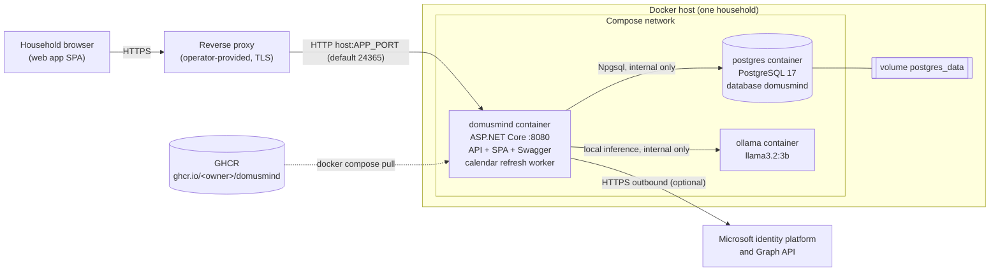
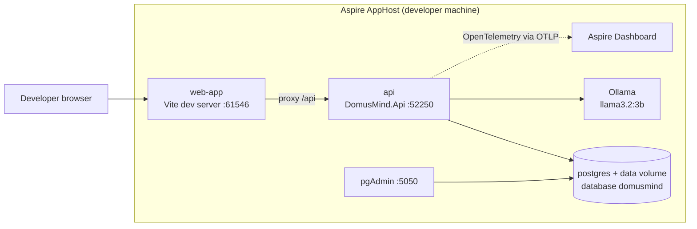

# Deployment View

DomusMind has three materially different deployment variants: the **self-hosted household installation** (the product runtime), the **public site** (marketing and documentation, no product data), and the **local development environment**. The build and release pipelines that produce the artifacts are operational concerns and live in [DevOps](../devops.md).

## Infrastructure Level 1: Self-Hosted Installation

### Overview

A household runs DomusMind on one Docker host as a Compose stack defined in [`deploy/docker-compose.yml`](../../deploy/docker-compose.yml), including PostgreSQL, the API and SPA, and a local Ollama model runtime. The operator supplies installation values in a host-side `.env` (template: [`deploy/.env.example`](../../deploy/.env.example)) and, for external access, their own TLS-terminating reverse proxy.

- **`domusmind`** is the only published service. Its image is built by [`src/backend/DomusMind.Api/Dockerfile`](../../src/backend/DomusMind.Api/Dockerfile): a Node stage builds the web app, a .NET SDK stage publishes the API with the web app's `dist` copied into `wwwroot`, and the runtime stage is `mcr.microsoft.com/dotnet/aspnet:10.0` listening on plain HTTP port 8080. The container maps to host port `APP_PORT` (default `24365`).
- **`postgres`** (`postgres:17-alpine`) has no host port; only the app reaches it over the Compose network. The app waits for its `pg_isready` health check before starting.
- **`postgres_data`** holds application and event-log state. **`ollama_data`** persists the local model download; model weights do not contain household notes. Back up PostgreSQL as the source of household state (see [DevOps](../devops.md#backup-and-restore)).
- **`ollama`** is reachable only on the Compose network. The one-shot `ollama-model` resource downloads `llama3.2:3b` into `ollama_data` before the API starts. The API sends note text to that local endpoint for interpretation; no hosted AI provider receives it. <!-- pdac:cite id="QR-INBOX-PRIVATE-HOUSEHOLD-DATA" digest="sha256:f52f383ec2b4c06033c30d4ff1864e663f25410b6772d5d12f90343df933e7d0" -->
- **Reverse proxy** is not part of the stack. The container speaks HTTP only; HTTPS and external exposure are the operator's responsibility, following the pattern `https://domusmind.example.com -> http://host:24365`. Forwarded scheme, host and client address are honored only from explicitly configured proxy IPs or networks; forwarded hosts can also be allowlisted. The proxy owns public HTTP-to-HTTPS redirection.
- **Application diagnostics** use the image health check against `/api/system/ping`; Compose exposes its health status. The API logs the image version and commit at startup. Swagger is enabled in Development and disabled by default in Production, where an operator can enable it through configuration.
- **Microsoft identity platform and Graph** are reached outbound only when a member connects an Outlook calendar; the Graph client and the periodic refresh worker run inside the `domusmind` process (see [ADR-0003](../adr/0003-use-delegated-graph-auth-for-outlook-calendar-ingestion.md)).

On every start the application applies pending EF Core migrations, then runs the optional bootstrap-admin seed and the supported-language seed before serving requests ([`Program.cs`](../../src/backend/DomusMind.Api/Program.cs)). There is no separate migration job.

### Topology Rationale

One household installs one instance, and the whole product ships as one image because the backend is a single modular monolith ([ADR-0004](../adr/0004-build-a-domain-centric-modular-monolith.md)) and the web app is served from that same process, so the browser always talks same-origin to `/api` and no CORS or second web server is needed. Multi-tenant hosting is not a driver of the topology.
<!-- pdac:cite id="CON-PRODUCT-CURRENT-SCOPE" digest="sha256:e15c25852c199d0df3faf9577a99856fd533d983e101c646149c85d10308ae64" -->

Keeping PostgreSQL off the host network makes the application the single entry point to household data; all authentication and family-scoped authorization happen in that process (see [Crosscutting Concepts](08-crosscutting-concepts.md#authentication-authorization-and-identity-separation)).

### Quality and Performance Characteristics

- **Single instance.** The stack runs one application replica. The external-calendar sync lease (a database-backed lease per connection) prevents overlapping syncs between the worker and user-triggered syncs. Shared-list change notices use an in-process notifier and server-sent events, so multiple application replicas would need a shared notification channel. The reverse proxy must pass `text/event-stream` responses through without buffering; clients reconnect and reload the list after a disconnect.
- **Availability** relies on `restart: unless-stopped` for both services. PostgreSQL and the application have health checks; the app probe calls `GET /api/system/ping` from inside the image.
- **Upgrades** replace the image and restart; schema migration happens at startup, so an upgrade is a restart that may take longer while migrations run.
- **Transport security** is outside the container. The container has no HTTPS listener. Forwarded-header middleware runs before HTTPS redirection and accepts headers only from configured proxy sources; direct local HTTP remains supported when no HTTPS port is configured.

### Building Block Mapping

| Building block or artifact | Infrastructure element | Environment |
| --- | --- | --- |
| `DomusMind.Api` with `Application`, `Domain`, `Infrastructure`, `Contracts` (one process) | `domusmind` container, port 8080 | Self-hosted |
| Web app (`src/web/app`, React + Vite build) | Static files in the `domusmind` container's `wwwroot`, SPA fallback in ASP.NET Core | Self-hosted |
| `ExternalCalendarRefreshWorker` hosted service | Inside the `domusmind` process | Self-hosted |
| `DomusMindDbContext` schema and event log | `postgres` container, database `domusmind`, volume `postgres_data` | Self-hosted |
| Container image | GHCR `ghcr.io/<owner>/domusmind` | Registry |
| Compose file, `.env.example`, install README | GitHub Release assets | Distribution |

## Infrastructure Level 1: Public Site

The public site ([`src/web/public`](../../src/web/public), Astro, `https://domusmind.org`) is a static build deployed to **Azure Static Web Apps** by [`public-site-cd.yml`](../../.github/workflows/public-site-cd.yml) on pushes to `main` that touch it. It has no API, holds no household data and shares no runtime with the product; [`staticwebapp.config.json`](../../src/web/public/staticwebapp.config.json) only configures navigation fallback.

| Building block or artifact | Infrastructure element | Environment |
| --- | --- | --- |
| Public site static build (`dist`) | Azure Static Web Apps (GitHub environment `production`) | Hosted |

## Infrastructure Level 1: Engineering Documentation Site

The Engineering documentation site is a separate static publication on GitHub
Pages. The [`engineering-site.yml`](../../.github/workflows/engineering-site.yml)
workflow builds its landing page and self-contained arc42, ADR and ProductShape
snapshots from the repository. It contains no product runtime or household data.
Its deployment uses GitHub's Pages artifact and short-lived OIDC permissions;
it does not share the Azure public-site deployment or credential. The publication
and one-time Pages setup are documented in [Engineering site](../engineering-site.md).

| Building block or artifact | Infrastructure element | Environment |
| --- | --- | --- |
| Engineering landing page and documentation snapshots | GitHub Pages | Hosted |

## Infrastructure Level 1: Local Development

Development uses .NET Aspire through [`DomusMind.AppHost`](../../src/backend/DomusMind.AppHost/AppHost.cs); it is never used in production. Aspire provisions PostgreSQL and the local Ollama model resource for Inbox interpretation.

Aspire provisions PostgreSQL with a data volume and pgAdmin, injects the `domusmind` connection string into the API, and runs the web app from source through Vite, which proxies `/api` to the API. In Development, the API exports HTTP server/client and PostgreSQL spans plus runtime and HTTP metrics to the local Aspire Dashboard when Aspire injects an OTLP endpoint. HTTP traces omit raw paths and query strings; outbound HTTP spans retain the host and method while omitting URL paths and queries. Aspire MCP exposes structured and console logs from resources; application log messages omit identities, credentials, exception contents and household payloads. Unlike the self-hosted image, the SPA is not served by ASP.NET Core here; with no `wwwroot`, the API root redirects to Swagger. See [local development](../devops.md#local-development-and-aspire-telemetry) for setup.

| Building block or artifact | Infrastructure element | Environment |
| --- | --- | --- |
| `DomusMind.Api` | Aspire project resource `api` | Development |
| Web app source | Aspire Vite resource `web-app` | Development |
| Database | Aspire PostgreSQL resource with pgAdmin | Development |
| Local model | Aspire Ollama resource with `llama3.2:3b` | Development |
